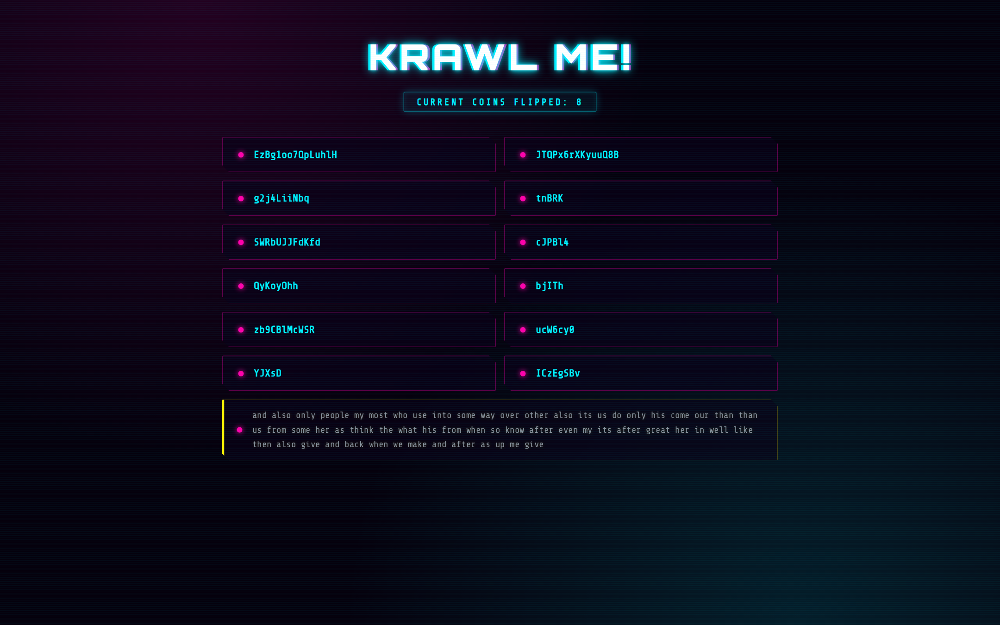
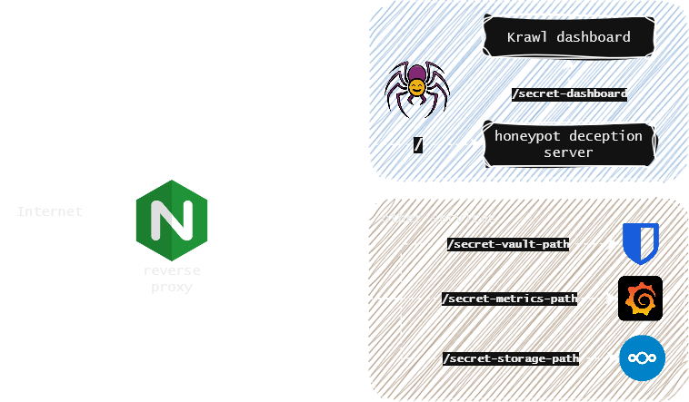
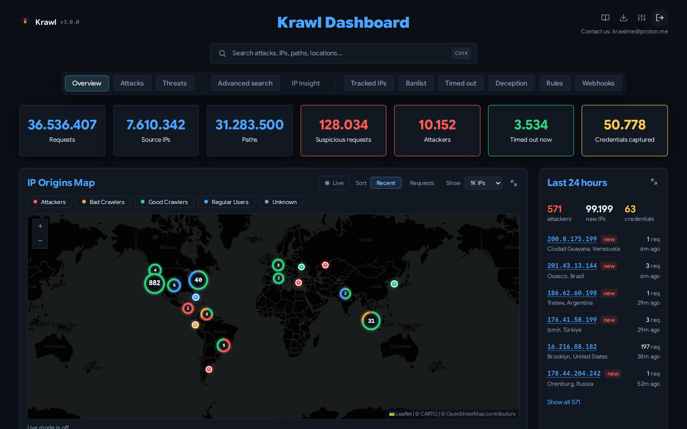
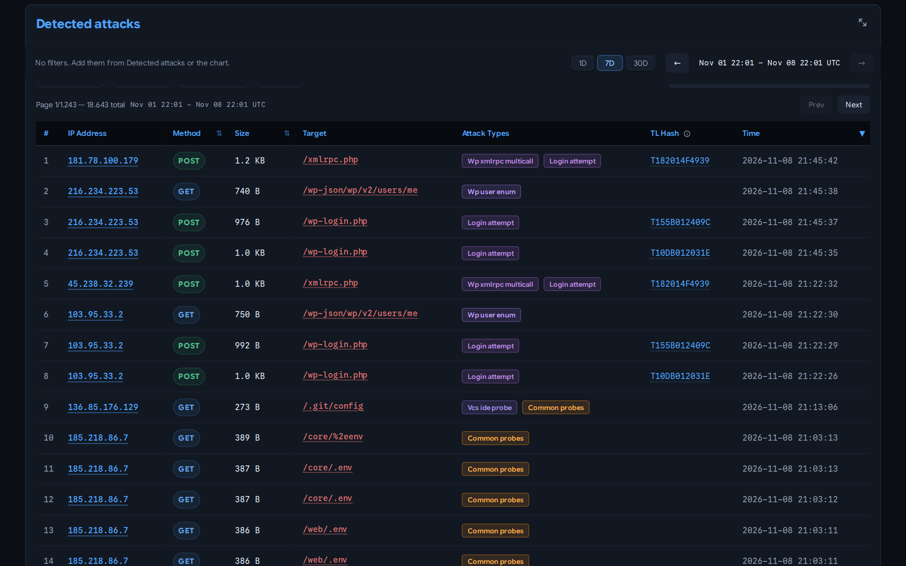
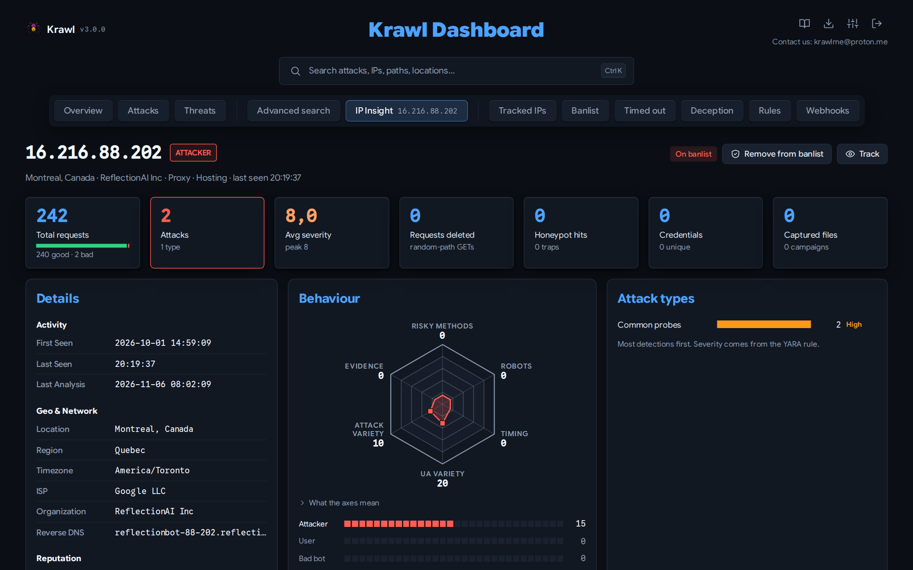
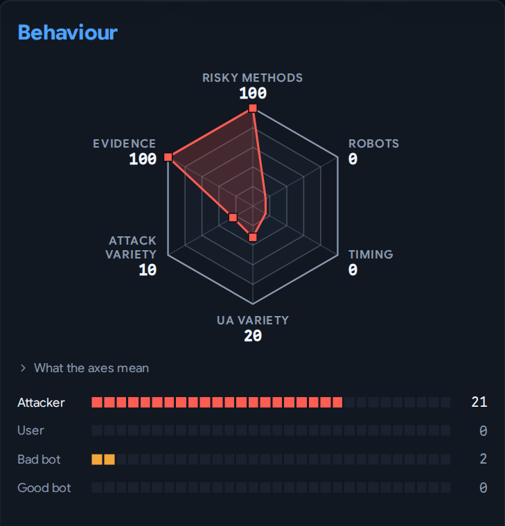

<h1 align="center">Krawl</h1>

<h3 align="center">
  <a name="readme-top"></a>
  
</h3>
<div align="center">

<p align="center">
  A modern, customizable web honeypot server designed to detect and track malicious activity from attackers and web crawlers through deceptive web pages, fake credentials, and canary tokens.
</p>

<p align="center">
  <a href="https://blessedrebus.github.io/Krawl/"></a>
</p>
<p align="center">
  <a href="https://blessedrebus.github.io/Krawl/config-builder/"></a>
  <a href="https://blessedrebus.github.io/Krawl/rule-builder/"></a>
  <a href="http://demo.krawlme.com/das_dashboard"></a>
</p>

<div align="center">
  <a href="https://github.com/blessedrebus/krawl/blob/main/LICENSE">
    
  </a>
  <a href="https://github.com/blessedrebus/krawl/releases">
    
  </a>
</div>

<div align="center">
  <a href="https://ghcr.io/blessedrebus/krawl">
    
  </a>
  <a href="https://kubernetes.io/">
    
  </a>
  <a href="https://github.com/BlessedRebuS/Krawl/pkgs/container/krawl-chart">
    
  </a>
</div>
</div>

## Table of Contents
- [Demo](#demo)
- [What is Krawl?](#what-is-krawl)
- [Krawl Dashboard](#krawl-dashboard)
- [Deployment Modes](#deployment-modes)
- [Krawl Banlist](#krawl-banlist)
- [Quickstart](#quickstart)
  - [Docker Run](#docker-run)
  - [Docker Compose](#docker-compose)
  - [Kubernetes](#kubernetes)
  - [Uvicorn (Python)](#uvicorn-python)
- [Configuration](#configuration)
- [Ban Malicious IPs](#use-krawl-to-ban-malicious-ips)
- [Attack Detection](#attack-detection)
- [IP Reputation](#ip-reputation)
- [Deception using AI](#ai-generated-deception-pages)
- [Running Behind a Reverse Proxy or CDN](#running-behind-a-reverse-proxy-or-cdn)
- [Metrics & Monitoring](#metrics--monitoring)
- [Documentation](#documentation)
- [Contributing](#contributing)

## Demo
Tip: crawl the `robots.txt` paths for additional fun
### Krawl URL: [http://demo.krawlme.com](http://demo.krawlme.com)
### View the dashboard [http://demo.krawlme.com/das_dashboard](http://demo.krawlme.com/das_dashboard)

## What is Krawl?

**Krawl** is a cloud‑native deception server designed to detect, delay, and analyze malicious attackers, web crawlers and automated scanners.

It creates realistic fake web applications filled with low‑hanging fruit such as admin panels, configuration files, and exposed fake credentials to attract and identify suspicious activity.



By wasting attacker resources, Krawl helps clearly distinguish malicious behavior from legitimate crawlers.

It features:

- **[AI Generated Deception Pages](docs/ai_generation.md)**: **Let attackers help generate your fake vulnerable attack surface**
- **Spider Trap Pages**: Infinite random links to waste crawler resources based on the [spidertrap project](https://github.com/adhdproject/spidertrap)
- **Fake Login Pages**: WordPress, phpMyAdmin, admin panels
- **Honeypot Paths**: Advertised in robots.txt to catch scanners
- **Fake Credentials**: Realistic-looking usernames, passwords, API keys
- **[Canary Token](docs/canary-token.md) Integration**: External alert triggering
- **Random server headers**: Confuse attacks based on server header and version
- **Real-time Dashboard**: Monitor suspicious activity
- **[YARA Attack Detection](docs/detection.md)**: over 3,100 bundled rules for web attacks, exploit payloads, over 2,500 CVEs, IoT botnets and exposure probes, answered with matching fake replies
- **Customizable fake content**: every fake page and attack reply is a file listed in `responses/manifest.yaml`
- **Random Error Injection**: Mimic real server behavior

You can easily expose Krawl alongside your other services to shield them from web crawlers and malicious users using a reverse proxy. For more details, see the [Reverse Proxy documentation](docs/reverse-proxy.md).



## Krawl Dashboard

Krawl provides a comprehensive dashboard, accessible at a **random secret path** generated at startup or at a **custom path** configured via `KRAWL_DASHBOARD_SECRET_PATH`. This keeps the dashboard hidden from attackers scanning your honeypot.

Five tabs are open to anyone with the dashboard path:

- **Overview**: high-level view of attack activity: an interactive map of IP origins, recent suspicious requests, and top IPs, User-Agents, and paths.



- **Attacks**: detailed breakdown of captured credentials, honeypot triggers, and detected attack types (SQLi, XSS, path traversal, etc.) with charts and tables.



- **Threats**: payloads grouped into campaigns by TLSH fuzzy hash, so a webshell and its edited variants read as one campaign rather than unrelated hits, with an index of every captured file.

- **Advanced search**: find stored requests by path, host, IP, referer, user agent, method, raw request text and HTTP headers.

- **IP Insight**: in-depth forensic view of a selected IP: geolocation, ISP/ASN info, reputation flags, a behaviour hexagon, ranked attack types, good and bad request counts, average severity, referer history, captured files and credentials, category timeline, and full access history.



Additionally, after authenticating with the dashboard password, protected tabs become available:

- **Tracked IPs**: maintain a watchlist of IP addresses you want to monitor over time.
- **IP Banlist**: manage IP bans, view detected attackers, and export the banlist in raw or IPTables format.
- **Timed out**: review the IPs serving an automatic rate-limit time-ban, and exempt any that should not be.
- **Deception**: manage AI generated pages, export them or import new ones.
- **Rules**: browse the loaded YARA rules with their metadata, fake reply and match counts, and upload or delete your own rule files without a restart.
- **Webhooks**: forward bans to CloudFlare and other firewalls.

The header icons open the [documentation](https://blessedrebus.github.io/Krawl/), the banlist export, and a settings panel showing the running configuration and a maintenance page for running scheduled tasks on demand.

For more details, see the [Dashboard documentation](docs/dashboard.md).

## Deployment Modes

Krawl supports two deployment modes, controlled by the `mode` setting in `config.yaml` or the `KRAWL_MODE` environment variable.

| | Standalone | Scalable |
|---|---|---|
| **Database** | SQLite (WAL mode) | PostgreSQL |
| **Cache** | In-memory Python dict | Redis (multi-tier TTL) |
| **Replicas** | 1 (single instance) | 1+ (horizontal scaling) |
| **External deps** | None | PostgreSQL + Redis |
| **Best for** | Dev, homelabs, <500k requests | Production, HA, >500k requests |

**Standalone**: ideal for development environments or homelabs with low request counts. Zero additional configuration needed, just run Krawl and it works.
- Single container deployment with no external dependencies
- Lower RAM and resource usage

**Scalable**: designed for production environments or high-traffic honeypots. The Helm chart defaults to this mode.
- Faster, more responsive dashboard thanks to Redis multi-tier caching
- Lower disk I/O with Redis acting as a hot-path cache in front of PostgreSQL
- Horizontal scaling increase the number of Krawl replicas behind a load balancer

For detailed configuration, Docker Compose examples, Kubernetes/Helm setup, and step-by-step migration instructions, see the [Deployment Modes documentation](docs/deployment-modes.md).

## Krawl Banlist

Krawl maintains a regularly updated [`banlist.txt`](banlist.txt) of IP addresses from **attackers that triggered its honeypot traps**. The banlist is published weekly and available for download, helping the community preemptively block known malicious actors even without using Krawl.

The banlist can also be fetched directly from:
[https://demo.krawlme.com/das_dashboard/api/export-ips?categories=attacker&fwtype=raw](https://demo.krawlme.com/das_dashboard/api/export-ips?categories=attacker&fwtype=raw).

### Sharing banlists between instances

Krawl instances can federate their banlists: each one can publish its own list on an
unauthenticated path and pull in lists from other instances (or any plain-text IP list).
Fetched IPs are merged into the local ban decisions and shown in the dashboard.

```yaml
banlist:
  # Public, unauthenticated download path for this instance's banlist.
  # Supports the same ?categories= and ?fwtype= parameters as the main API.
  # Empty = disabled.
  export_path: "/public_banlist.txt"

  # Upstream banlists to fetch and merge. Plain ".txt" lists work too.
  sources:
    - "https://demo.krawlme.com/das_dashboard/api/export-ips?categories=attacker&fwtype=raw"
    - "https://krawl.example.com/public_banlist.txt"

  refresh_interval: 3600  # seconds between fetches
```

## Quickstart

### Docker Run

Run Krawl in standalone mode with the latest image:

```bash
docker run -d \
  -p 5000:5000 \
  -e KRAWL_DASHBOARD_SECRET_PATH="/my-secret-dashboard" \
  -e KRAWL_DASHBOARD_PASSWORD="my-secret-password" \
  -v krawl-data:/app/data \
  --name krawl \
  ghcr.io/blessedrebus/krawl:latest
```

Access the server at `http://localhost:5000`

### Docker Compose

Create a `docker-compose.yaml` with one of the two deployment modes.

**Standalone**: just Krawl server with Sqlite storage:

```yaml
services:
  krawl:
    image: ghcr.io/blessedrebus/krawl:latest
    container_name: krawl-server
    ports:
      - "5000:5000"
    environment:
      - CONFIG_LOCATION=config.yaml
      # - KRAWL_DASHBOARD_PASSWORD=my-secret-password
    volumes:
      - ./config.yaml:/app/config.yaml:ro
      - krawl-data:/app/data
    restart: unless-stopped

volumes:
  krawl-data:
```

**Scalable**: with PostgreSQL and Redis:

> [!CAUTION]
> The example below uses **default passwords** (`krawl`/`krawl`). **Change them before deploying to production.**

```yaml
services:
  postgres:
    image: postgres:16-alpine
    environment:
      POSTGRES_DB: krawl
      POSTGRES_USER: krawl
      POSTGRES_PASSWORD: krawl
    volumes:
      - postgres_data:/var/lib/postgresql/data
    restart: unless-stopped
    healthcheck:
      test: ["CMD-SHELL", "pg_isready -U krawl -d krawl"]
      interval: 10s
      timeout: 5s
      retries: 5

  redis:
    image: redis:7-alpine
    volumes:
      - redis_data:/data
    restart: unless-stopped
    healthcheck:
      test: ["CMD", "redis-cli", "ping"]
      interval: 10s
      timeout: 5s
      retries: 5

  krawl:
    image: ghcr.io/blessedrebus/krawl:latest
    container_name: krawl-server
    ports:
      - "5000:5000"
    environment:
      - CONFIG_LOCATION=config.yaml
      - KRAWL_MODE=scalable
      - KRAWL_POSTGRES_HOST=postgres
      - KRAWL_POSTGRES_PORT=5432
      - KRAWL_POSTGRES_USER=krawl
      - KRAWL_POSTGRES_PASSWORD=krawl
      - KRAWL_POSTGRES_DATABASE=krawl
      - KRAWL_REDIS_HOST=redis
      - KRAWL_REDIS_PORT=6379
      # - KRAWL_DASHBOARD_PASSWORD=my-secret-password
    volumes:
      - ./config.yaml:/app/config.yaml:ro
    restart: unless-stopped
    depends_on:
      postgres:
        condition: service_healthy
      redis:
        condition: service_healthy

volumes:
  postgres_data:
  redis_data:
```

To deploy, just run
```bash
docker compose up -d
```

Production-ready compose files are also available in the [`docker/`](docker/) directory. For **development** (builds from source with hot-reload), use the compose files in [`docker/dev/`](docker/dev/).

For more details on both modes, see [Deployment Modes](docs/deployment-modes.md).

### Kubernetes
**Krawl is also available natively on Kubernetes**. Installation can be done either [via manifest](kubernetes/README.md) or [using the Helm chart](helm/README.md).

The Helm chart **defaults to scalable mode** with bundled PostgreSQL and Redis:

```bash
helm install krawl oci://ghcr.io/blessedrebus/krawl-chart --version 3.0.0 \
  -n krawl-system --create-namespace \
  --set postgres.password=your-password \
  --set redis.password=your-redis-password \
  --set dashboardPassword=your-dashboard-password \
  --set config.dashboard.secret_path=/my-secret-dashboard
```

Minimal example values files are provided for both modes:
- [`values-minimal.yaml`](helm/values-minimal.yaml) ---> Scalable (default)
- [`values-standalone.yaml`](helm/values-standalone.yaml) ---> Standalone

See [Deployment Modes](docs/deployment-modes.md) and [Chart documentation](helm/README.md) for full configuration and migration instructions.

### Uvicorn (Python)

Run Krawl directly with Python 3.13+ and uvicorn for local development or testing:

```bash
pip install -r requirements.txt
uvicorn app:app --host 0.0.0.0 --port 5000 --app-dir src --no-server-header
```

Access the server at `http://localhost:5000`


## Configuration

Krawl reads [config.yaml](config.yaml); every setting can also be set with a
`KRAWL_*` environment variable, which wins over the file. The variable name is
`KRAWL_` plus the setting path in upper case, so `dashboard.password` becomes
`KRAWL_DASHBOARD_PASSWORD`.

See [Configuration](docs/configuration.md) for every variable and its default, or build a config with the [Config builder](https://blessedrebus.github.io/Krawl/config-builder/).

## Use Krawl to Ban Malicious IPs
Krawl uses a reputation-based system to classify attacker IP addresses and provides two ways to export IP lists for firewall integration.

The `/api/export-ips` endpoint queries the database directly and supports filtering by IP category (`attacker`, `bad_crawler`, `regular_user`, `good_crawler`) and output format (`raw`, `iptables`, `nftables`):

```bash
curl "https://your-krawl-instance/<DASHBOARD-PATH>/api/export-ips?categories=attacker&fwtype=raw"
```

This enables automatic blocking of malicious traffic across various platforms:
* [OPNsense and pfSense](https://ipv64.net/v64_blocklist_integration_guide)
* [RouterOS](https://rentry.co/krawl-routeros)
* [IPtables](plugins/iptables/README.md) and [Nftables](plugins/nftables/README.md)
* [Fail2Ban](plugins/fail2ban/README.md)

For full API parameters, examples, and adding custom firewall formats, see the [Firewall Exporters documentation](docs/firewall-exporters.md).

Krawl can also push banned IPs directly to a Cloudflare Account IP List for use in WAF rules. The sync runs as a background task and updates the list by full replacement on a configurable interval. See the [Cloudflare Banlist Sync](docs/cloudflare_banlist.md) documentation.

## Attack Detection

Every request is scanned by the [YARA](https://virustotal.github.io/yara/) rules in [`rules/`](rules/): SQL injection, XSS, path traversal, command injection, SSRF, SSTI, deserialization, webshells, exposure probes and the exploit requests of over 2,500 CVEs. A rule records the attack type, severity and MITRE ATT&CK mapping, and can name a fake reply from [`responses/manifest.yaml`](responses/manifest.yaml), so `/etc/passwd` returns a fake passwd file, a SQL injection gets a database error, and an SSRF to the cloud metadata address gets fake credentials.

Rules and replies are plain files: add a `.yar` rule, drop the fake files under `responses/`, list them in the manifest and restart. The [detection documentation](docs/detection.md) walks through the whole flow, from writing a rule to testing and shipping its fake reply, and the [Rule builder](https://blessedrebus.github.io/Krawl/rule-builder/) writes and tests a rule in your browser.

## IP Reputation
Every minute the [`analyze-ips`](src/tasks/analyze_ips.py) task scores each new or flagged IP from its last 30 days of requests and puts it in one category: `attacker`, `bad_crawler`, `good_crawler` or `regular_user`. IPs not analysed yet show as unknown. The category drives bans, banlist exports and the dashboard.



Five signals feed the score, each with a configurable threshold and weight:
- **Risky HTTP methods**: the share of POST, PUT, DELETE, OPTIONS and PATCH requests
- **robots.txt violations**: requests under a path Krawl's robots.txt disallows
- **Uneven timing**: bursty or irregular gaps between requests
- **User-Agent variety**: how many distinct user agents the IP sent
- **Attack detection**: attack types found by the [YARA rules](docs/detection.md)

The IP Insight page draws them as the radar above, with each category's score below it; the highest score wins. [How IPs are evaluated](docs/algorithms.md) has the scoring table and a worked example.

## AI-Generated Deception Pages

Krawl can automatically generate realistic deception pages using AI models from **OpenRouter**, **OpenAI**, or any OpenAI-compatible engine such as **Ollama** or **llama.cpp**. This feature creates unique, plausible honeypot pages on-the-fly to deceive attackers without manual page creation.

**Key Features:**
- **Dynamic Generation**: Creates unique HTML pages for any request path
- **Smart Caching**: Caches generated pages to avoid redundant API calls
- **Daily Rate Limiting**: Control API costs with configurable request limits
- **Multiple Providers**: OpenRouter (free options), OpenAI, or a local OpenAI-compatible engine
- **Graceful Fallback**: Falls back to standard honeypot when disabled or limit reached
- **Cached Serving**: Previously generated pages served even when AI is disabled

**Quick Setup:**

```yaml
ai:
  enabled: true
  provider: "openrouter"
  openai_base_url: "your-custom-base-url"
  api_key: "your-api-key"
  model: "nvidia/nemotron-3-super-120b-a12b:free"
  timeout: 60
  max_daily_requests: 10
```

For detailed configuration and usage, see the [AI Generation documentation](docs/ai_generation.md).

You can also **contribute deception templates** by opening a PR, see [Contributing Deception Templates](docs/deception_pages.md#contributing-deception-templates-via-pr).

## Running Behind a Reverse Proxy or CDN

**NGINX, Traefik, and other proxies like CloudFlare** need header forwarding so Krawl can see the real IP. See the [Reverse Proxy documentation](docs/reverse-proxy.md) for configuration examples and the full header list.

## Metrics & Monitoring

Krawl exposes [Prometheus](https://prometheus.io/) metrics at `/<dashboard_secret_path>/metrics` (enabled by default) and ships with a ready-to-import [Grafana](https://grafana.com/) dashboard at [`grafana-dashboard.json`](grafana-dashboard.json).

See the [Monitoring documentation](docs/monitoring.md) for the full metric list, Grafana import steps, and Prometheus / Kubernetes (`ServiceMonitor`) scraping setup.

## Documentation

The full documentation is live at **[blessedrebus.github.io/Krawl](https://blessedrebus.github.io/Krawl/)**, and its source is in [docs/](docs/index.md): configuration,
deployment, detection rules, the dashboard, the API and operations. Upgrading
from 2.4? Start with [Upgrading from 2.4 to 3.0](docs/upgrading.md).

Two interactive tools live there too:
- **[Config builder](https://blessedrebus.github.io/Krawl/config-builder/)**: every setting as a form field, copied out as `config.yaml`, environment variables or Helm values.
- **[Rule builder](https://blessedrebus.github.io/Krawl/rule-builder/)**: write a YARA rule, validate it against Krawl's rule contract and test it on a request before uploading it.

## Contributing

Contributions welcome! Please:
1. Fork the repository
2. Create a feature branch
3. Make your changes
4. Submit a pull request (explain the changes!)


## Disclaimer
> [!CAUTION]
> This is a deception/honeypot system. Deploy in isolated environments and monitor carefully for security events. Use responsibly and in compliance with applicable laws and regulations.

## Star History

