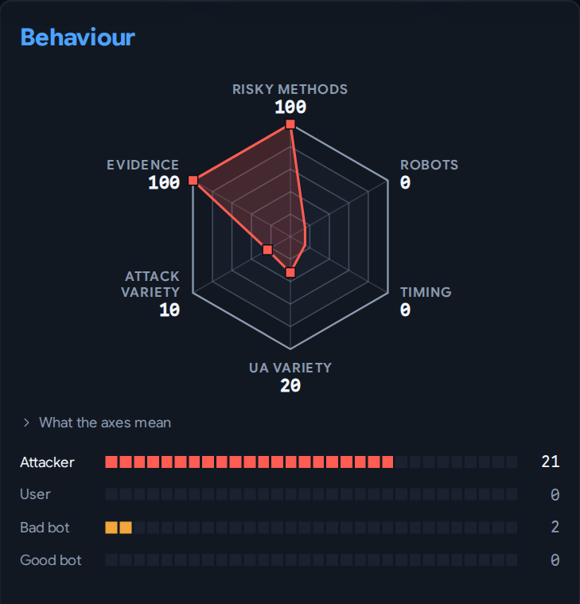

# Algorithms

How Krawl decides things. Each section: purpose, inputs, steps, a worked example,
config knobs, and known limits.

- [IP evaluation](#ip-evaluation)
- [Pruning uninteresting requests](#pruning-uninteresting-requests)

## IP evaluation

**Purpose.** Assign every IP one category — `attacker`, `bad_crawler`,
`good_crawler` or `regular_user` — from its behaviour. The category drives bans,
banlist exports and the dashboard.

**When.** `analyze-ips` runs every minute and takes up to `tasks.analyze_ips_batch`
IPs (default 2000): those never analysed, then those flagged `need_reevaluation`,
oldest analysis first. `flag-stale-ips` (daily) flags IPs seen within
`retention.non-suspicious` whose last analysis is older than
`retention.re-evaluate-interval`. Manually categorised IPs are never re-flagged.

**Inputs.** The IP's access logs from the last 30 days, at most 10,000 rows.

**Signals.** Each signal is a yes/no flag per category:

| Signal | Measure | Fires when (config) |
|---|---|---|
| Risky methods | share of POST/PUT/DELETE/OPTIONS/PATCH requests | ≥ `analyzer.http_risky_methods_threshold` (0.1) |
| robots.txt violations | share of requests under a `Disallow:` path of Krawl's robots.txt | ≥ `analyzer.violated_robots_threshold` (0.1) |
| Uneven timing | coefficient of variation (std/mean) of gaps between requests in the last `analyzer.uneven_request_timing_time_window_seconds` (300s) | ≥ `analyzer.uneven_request_timing_threshold` (0.5) |
| Many user agents | distinct user agents | ≥ `analyzer.user_agents_used_threshold` (2) |
| Attack URLs | distinct attack types stored for the IP's requests in the window (any field: path, query, body, headers), as detected when each request arrived | ≥ `analyzer.attack_urls_threshold` (1) |

**Scoring.** Each category's score is the sum of the weights of the signals that
fired *for that category*. Default weights (overridable with `analyzer.scoring_weights`
in `config.yaml`):

| Signal | attacker | good_crawler | bad_crawler | regular_user |
|---|---|---|---|---|
| Risky methods | 6 (fires if high) | 1 (fires if **low**) | 2 (fires if high) | 0 |
| robots.txt violations | 4 | 0 | 6 | 0 |
| Uneven timing | 3 | 0 | 0 | 8 |
| Many user agents | 2 | 0 | 6 | 3 |
| Attack URLs | 15 | 0 | 4 | 0 |

The highest score wins. On a tie, the first category in the order attacker,
good_crawler, bad_crawler, regular_user wins.

**Worked example.** An IP sends 40 GETs, 4 POSTs (9% risky), 6 requests under
`/admin` (a `Disallow` path, 14%), with 2 user agents and one `/.env` probe:

- attacker = 4 (robots) + 2 (UAs) + 15 (attack URL) = **21**
- good_crawler = 1 (risky share is low)
- bad_crawler = 6 (robots) + 6 (UAs) = 12
- regular_user = 0

The IP becomes an `attacker`.

**Known limits** (current behaviour, kept as is):

- The risky-method ratio is computed only when the row count exceeds
  `http_risky_methods_threshold` (0.1), so in practice always.
- The `regular_user` "many user agents" flag is never set, so its weight (3) is unused.
- The stored `uneven_request_timing` metric is the mean gap. The CV that the
  threshold compares is stored as `request_timing_cv`.
- Pruned requests still count in the ratio denominators, so pruning doesn't move
  a category (see below).

## Pruning uninteresting requests

**Purpose.** Most stored requests are crawlers following Krawl's own random
homepage links: on the demo instance about 3M IPs, each with a handful of unique
paths like `/Gw2JM958`. Nobody needs those after a week, so they are marked when
written and deleted early, with no per-IP reads of the access log.

**Marking.** A request is uninteresting only if all of these hold, otherwise
`access_logs.is_interesting` stays true:

- the method is `GET`
- it is not suspicious and not a honeypot trigger
- it has no attack types, uploaded files or request assets
- the whole path is one segment of `links.char_space` characters, within
  `links.min_length`..`max_length`, with a digit or an uppercase letter after the
  first character
- it is not under a robots.txt `Disallow` prefix

The rule also matches readable names with a digit or inner capital, like `/HNAP1`,
`/GponForm`, `/MyAdmin` and `/test1`. These weren't flagged as suspicious, so losing
them after the window is accepted. All-lowercase paths like `/kpjud` and paths with
more than one segment are kept. Rows stored before marking existed stay interesting
and age out under `retention.non-suspicious`.

**When.** `prune-uninteresting` runs every 4 hours and deletes uninteresting rows
older than `retention.uninteresting` (7d), in batches of
`tasks.retention_delete_batch`, through a partial index.

**Counters.** Each batch updates `ip_stats` in the same transaction as the delete:

- `pruned_requests` and `pruned_previous` count two consecutive periods, each as long
  as a pruned request stays inside the 30-day analysis window (23 days by default).
  IP evaluation adds an estimate from the two to its denominators: the current period
  plus the part of the previous one still in the window, assuming a steady rate.
  GETs from more than two periods ago count for nothing, so they can't hide a new
  attack. A burst from an IP that then went idle can count for up to one extra period.
- `pruned_total` never restarts. IP evaluation ignores it.

**IP evaluation.** Pruned rows are GETs outside robots paths, so they can only add
to the risky-method and robots denominators, which `pruned_requests` restores. Timing
reads only the last 300s by default; if
`uneven_request_timing_time_window_seconds` is set above the prune window, timing sees
fewer rows. While an IP has pruned requests, its previous user-agent list is merged
with the current one, so pruning can't lower the distinct count; those user agents can
stay counted past 30 days. Rows with detections are never pruned.

**Effects elsewhere.**
- Top User-Agents and unique-path counts drop, because pruned rows stop counting.
- Top Paths loses mostly random trap links.
- All-time totals are unaffected: they come from `ip_stats.total_requests`.
