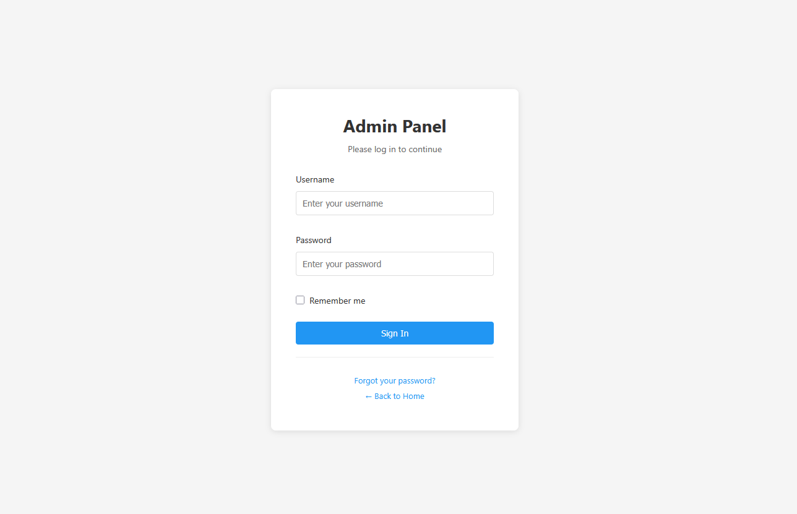
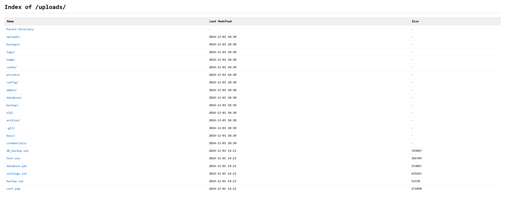
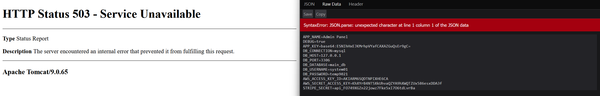
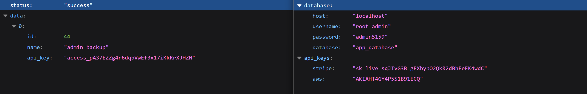
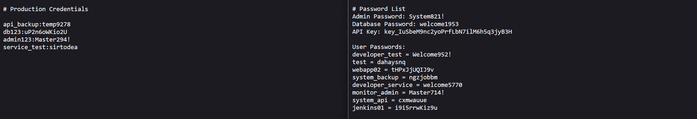
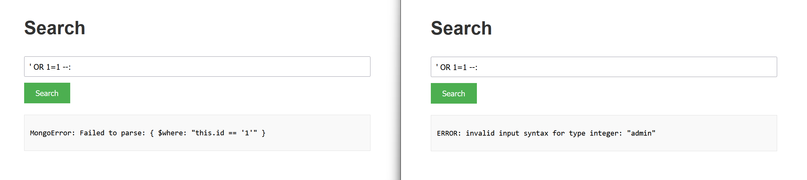

# Honeypot

Below is a complete overview of the Krawl honeypot's capabilities

## How a request is answered

Every fake reply comes from files in `responses/`, listed in
[`responses/manifest.yaml`](../responses/manifest.yaml). Krawl tries three
layers in order:

1. **YARA reply.** A rule fired and its `response_type` allows the method; see
   [Response types](detection.md#response-types).
2. **Page.** The request path is in the manifest's `pages:` section and the
   entry allows the method.
3. **Trap maze.** Any other GET gets a page of random links, with the canary
   token, crawl limit, tarpit and AI pages (see [Tarpit](tarpit.md) and
   [AI generation](ai_generation.md)).

Every POST and PUT goes through credential capture first, whatever answers it:
form fields named in `credentials.username_fields` and
`credentials.password_fields` (in `config.yaml`) are logged. The reply is then
the page for that path if it allows the method, otherwise the `login_failed`
page.

### The pages: section

```yaml
pages:
  /login:
    aliases: [/admin, /admin/, /admin/login]
    content_type: text/html
    files: [pages/login_form/*.html]
  /api/contact:
    methods: [POST]
    echo: true                  # reflects {{path}}, {{query}}; adds CSP script-src 'none'
    content_type: text/html
    files: [pages/contact_reply/*.html]
  /api/:                        # trailing slash: prefix match
    content_type: application/json
    files: [pages/api_default/*.json]
  login_failed:                 # required: reply to any other POST/PUT
    content_type: text/html
    files: [pages/login_failed/*.html]
```

- `content_type` and `files` are required. `methods` defaults to `[GET, HEAD]`,
  `status` to `[200]`, `echo` to `false`, `aliases` to `[]`. One file and one
  status are picked at random per request.
- A key or alias ending in `/` matches everything below it; the longest prefix
  wins, and an exact path beats any prefix. Matching is case-sensitive and
  ignores the query string.
- `/robots.txt` and `login_failed` are required. `/robots.txt` lists exactly one
  file, because IP scoring and the AI page filter read its `Disallow:` lines.
- The trap maze's page shell is `responses/trap/main_page.html`
  (`custom_template_path` still overrides it).
- Krawl does not start when an entry has an unknown key, a path is listed twice,
  a glob matches no file, or a file is empty, over 256 KB or outside
  `responses/`.

To add a bait page, add its files under `responses/pages/<name>/` and an entry
to `pages:`, then restart Krawl. Pages holding fake accounts or secrets should
ship at least five files, so repeated requests differ. Replace the bundled files
in your deployment: they are the same in every Krawl install.

`/api/contact` reflects the query string only; the POST body is captured but not
echoed back.

### Moving from wordlists.json

Krawl no longer reads `wordlists.json`. If one is still mounted, Krawl logs one
warning at startup and ignores it. Move any values you customised:

| wordlists.json key | Now |
|---|---|
| `proxy_headers` | `server.proxy_headers` in `config.yaml` (`KRAWL_PROXY_HEADERS`) |
| `server_headers` | `server.server_headers` in `config.yaml` (`KRAWL_SERVER_HEADERS`) |
| `credential_fields.username_fields` | `credentials.username_fields` (`KRAWL_CREDENTIAL_USERNAME_FIELDS`) |
| `credential_fields.password_fields` | `credentials.password_fields` (`KRAWL_CREDENTIAL_PASSWORD_FIELDS`) |
| `error_codes` | `behavior.error_codes` |
| `scoring_weights` | `analyzer.scoring_weights` |
| `usernames`, `passwords`, `emails`, `api_keys`, `databases`, `applications`, `users`, `directory_listing`, `server_errors`, `sql_errors` | files under `responses/pages/` (bait pages) and `responses/sql_error/` (SQL errors) |
| `attack_patterns`, `suspicious_patterns`, `fake_*`, `xxe_responses`, `command_outputs` | removed; detection is YARA-only and attack replies are files under `responses/` |

In Helm, the `wordlists:` values and their ConfigMap are gone; set the keys
above under `config:` instead.

## robots.txt
The actual (juicy) robots.txt configuration [is the following](../responses/pages/robots/robots.txt).

## Honeypot pages

### Common Login Attempts
Requests to common admin endpoints (`/admin/`, `/wp-admin/`, `/phpMyAdmin/`) return a fake login page. Any login attempt triggers a 1-second delay to simulate real processing and is fully logged in the dashboard (credentials, IP, headers, timing).



### Common Misconfiguration Paths
Requests to paths like `/backup/`, `/config/`, `/database/`, `/private/`, or `/uploads/` return a fake directory listing populated with "interesting" files.



### Environment File Leakage
The `.env` endpoint exposes fake database connection strings, **AWS API keys** and API secrets, as plain text.

### Server Error Information
The `/server` page returns a fake 500 error page from Apache, nginx or IIS.



### API Endpoints with Sensitive Data
The pages `/api/v1/users` and `/api/v2/secrets` show fake users and random secrets in JSON format



### Exposed Credential Files
The pages `/credentials.txt` and `/passwords.txt` show fake users and random secrets



### SQL Injection and XSS Detection
Pages such as `/users`, `/search`, `/contact`, `/info`, `/input`, and `/feedback`, along with APIs like `/api/sql` and `/api/database`, are designed to lure attackers into performing attacks such as **SQL injection** or **XSS**.



Automated tools like **SQLMap** receive a database error picked from several files, matched to the database the payload targets (MySQL, PostgreSQL or SQL Server). All detected attacks are logged and displayed in the dashboard.

### Path Traversal Detection
Krawl detects and responds to **path traversal** attempts targeting common system files like `/etc/passwd`, `/etc/shadow`, or Windows system paths. When an attacker tries to access sensitive files using patterns like `../../../etc/passwd` or encoded variants (`%2e%2e/`, `%252e`), Krawl returns convincing fake file contents with realistic system users, UIDs, GIDs, and shell configurations. This wastes attacker time while logging the full attack pattern.

### XXE (XML External Entity) Injection
The `/api/xml` and `/api/parser` endpoints accept XML input and are designed to detect **XXE injection** attempts. When attackers try to exploit external entity declarations (`<!ENTITY`, `<!DOCTYPE`, `SYSTEM`) or reference entities to access local files, Krawl responds with realistic XML responses that appear to process the entities successfully. The honeypot returns fake file contents, simulated entity values (like `admin_credentials` or `database_connection`), or realistic error messages, making the attack appear successful while fully logging the payload.

### Command Injection Detection
Pages like `/api/exec`, `/api/run`, and `/api/system` simulate command execution endpoints vulnerable to **command injection**. When attackers attempt to inject shell commands using patterns like `; whoami`, `| cat /etc/passwd`, or backticks, Krawl responds with realistic command outputs. For example, `whoami` returns fake usernames like `www-data` or `nginx`, while `uname` returns fake Linux kernel versions. Network commands like `wget` or `curl` simulate downloads or return "command not found" errors, creating believable responses that delay and confuse automated exploitation tools.
