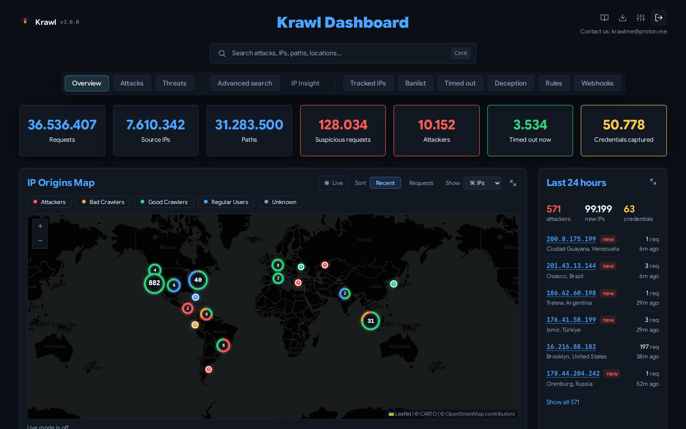

---
hide:
  - navigation
  - toc
---

<div class="krawl-hero" markdown>

{ .krawl-logo }

# Krawl

<p class="krawl-tagline">A deception server that <strong>detects, delays and profiles</strong>
attackers, web crawlers and automated scanners.</p>

[Get started](#quick-start){ .md-button .md-button--primary }
[Try the demo](http://demo.krawlme.com/das_dashboard){ .md-button }
[GitHub](https://github.com/BlessedRebuS/Krawl){ .md-button }

</div>

Krawl serves realistic fake applications, such as admin panels, exposed
configuration files and leaked credentials. It detects attacks with YARA rules,
answers each one with a convincing fake reply, and classifies every client IP
by its behaviour. A dashboard shows all of it, and banlists export to your
firewall.



## Quick start

```bash
docker run -d \
  -p 5000:5000 \
  -e KRAWL_DASHBOARD_SECRET_PATH="/my-secret-dashboard" \
  -e KRAWL_DASHBOARD_PASSWORD="my-secret-password" \
  -v krawl-data:/app/data \
  --name krawl \
  ghcr.io/blessedrebus/krawl:latest
```

The trap answers on `http://localhost:5000`, the dashboard on
`http://localhost:5000/my-secret-dashboard`. Docker Compose, Kubernetes and
Helm are covered in [Deployment modes](deployment-modes.md).

!!! warning "Upgrading from 2.4?"
    Read [Upgrading from 2.4 to 3.0](upgrading.md) first.

## Documentation

<div class="grid cards" markdown>

-   :material-cog:{ .lg } **Set up**

    ---

    [Configuration](configuration.md): `config.yaml` and every `KRAWL_*` variable<br>
    [Config builder](config-builder.md): pick settings, copy YAML or env<br>
    [Deployment modes](deployment-modes.md): SQLite, or PostgreSQL and Redis<br>
    [Reverse proxy](reverse-proxy.md): NGINX, CDNs and decoy subdomains<br>
    [Upgrading from 2.4 to 3.0](upgrading.md)

-   :material-spider-web:{ .lg } **How it works**

    ---

    [Honeypot](honeypot.md): bait pages and the `pages:` manifest<br>
    [Attack detection](detection.md): YARA rules and fake replies<br>
    [How IPs are evaluated](algorithms.md): categories and pruning<br>
    [Tarpit](tarpit.md) · [AI generation](ai_generation.md) ·
    [Deception pages](deception_pages.md) · [Canary token](canary-token.md)

-   :material-chart-box:{ .lg } **Use the data**

    ---

    [Dashboard](dashboard.md): every tab, with screenshots<br>
    [Dashboard API](dashboard-api.md): JSON API, with an [API reference](api-reference.md)<br>
    [Firewall exporters](firewall-exporters.md): raw, iptables, nftables<br>
    [Cloudflare banlist](cloudflare_banlist.md) · [Monitoring](monitoring.md)

-   :material-server:{ .lg } **Operate**

    ---

    [Retention](retention.md): how long each kind of data is kept<br>
    [Backups](backups.md): the scheduled database dump<br>
    [External APIs](api.md): third-party IP data services

-   :material-code-braces:{ .lg } **Develop**

    ---

    [Architecture](architecture.md): code layout, pipeline, schema, tasks<br>
    [Coding guidelines](coding-guidelines.md): conventions for contributors

</div>
